# Quadlet Homelab

**[🇧🇷 Leia em português](./docs/pt-BR/README.md)**

84 self-hosted services as [Podman Quadlet](https://docs.podman.io/en/latest/markdown/podman-systemd.unit.5.html)
units, rootless, one service per folder.

## Quick start

```bash
curl -fsSL https://raw.githubusercontent.com/wallacepnts/quadlet-homelab/main/bootstrap.sh | bash
```

Debian and Ubuntu ship neither `curl` nor `wget` in a bare install — measured
on their base images. There you are installing packages anyway, so install
`git`, which the bootstrap needs regardless:

```bash
git clone https://github.com/wallacepnts/quadlet-homelab
bash quadlet-homelab/bootstrap.sh
```

It checks git/python3/podman and `systemd --user`, creates Podman's folders,
clones the repository into `~/quadlet-homelab`, links the tools into `~/.local/bin`, and
**starts the web panel** as a `systemd --user` service of yours. No `sudo`, no packages
installed. It asks once where you will open the panel from (this machine only, the local
network, or the tailnet) and ends by printing the address and the login token:

```
  panel is up: http://127.0.0.1:8484
  login (the token): …
```

**Open that address in a browser: that is how you use this.** The panel has a Store (all
83 services, by category, with screenshots) and My apps (what is installed, as a launcher).
From it you install an app (it asks only what that app needs, and lets you customize ports,
volumes and variables first, or try it for a few hours), update it with one button, back it up,
restore it, change its settings, read its logs live, open a console in its container, pause,
stop or remove it, and see the host's load, memory and temperature. Every button runs the same
`qh` engine a terminal would; nothing in the panel is a second implementation.

Every service is reachable at `http://<host-ip>:<port>` with nothing else set
up — no domain, no certificate, no router change.

<details>
<summary>The terminal, if you prefer it (advanced)</summary>

```bash
qh                   # the services
qh memos             # the plan for one, without installing
qh memos --apply     # do it
```

[Installing and operating](./docs/installing.md) lists every mode.
</details>

## Updating

Two different things, in this order.

**The repository** — the units and the recipes. Re-run the same command, or
pull the clone; they do the same thing:

```bash
curl -fsSL https://raw.githubusercontent.com/wallacepnts/quadlet-homelab/main/bootstrap.sh | bash
```

It fast-forwards the clone and creates the links that are missing — one already
pointing at another clone is named, not moved. A clone that has diverged is left
alone and told about, so local edits are never dropped.

**The services on the host** — nothing moves until you say so. In the panel, an app with a
newer release shows an **Update to X** button, and My apps has **Update all** for the ones that
have something to take (each restarts; a failure does not stop the rest). A newer unit in the
repository does not change the file already installed. The same from a terminal:

```bash
qh-updates                     # which images are behind their upstream release
qh memos --update --apply      # one service
qh --all --update --apply      # after a round of bumps
```

`--update` re-copies the units, pulls the image and restarts. It touches no
volume, no `.env` and no secret. A service already in sync is skipped — and
that means the running container too, not just the file: Quadlet bakes the
labels in at creation, so a unit correct on disk can still be backed by a
container running the previous ones. A moving tag (`latest`) is always
pulled. To go through anyway, use `--reinstall`.

## Requirements

- **Podman 5.0 or newer.** This is the real floor: `Notify=healthy` arrived
  there, and 119 of the 127 units use it. On 4.x the start returns before the app
  is ready, and the install reports a success it cannot know about.
- **systemd with a user session** and cgroups v2.
- **`network-online.target` reached at boot.** Quadlet orders every unit it
  generates behind `podman-user-wait-network-online.service`, which loops on
  `until systemctl is-active network-online.target` until its 90s timeout. A
  target is only activated when something wants it, and desktops often want
  nothing — measured on Tumbleweed with KDE, where the one unit asking for it
  was a oneshot that had already finished. The dependency is `Wants=`, so the
  service does come up: ninety seconds late, on every single start.
  `sudo systemctl add-wants multi-user.target network-online.target` settles
  it, and the boot then waits for `NetworkManager-wait-online` — seconds when
  the machine has a network, `NM_ONLINE_TIMEOUT` when it does not.
- **SELinux**, if your distribution has it. The units carry `:Z` on 125 volume
  lines; where SELinux is absent those are ignored and nothing breaks, but the
  per-container isolation they ask for is not there either. The six units that
  mount Podman's socket need more than a label — `:z` alone leaves them healthy
  and blind, seeing no containers at all, so they declare
  `SecurityLabelType=container_runtime_t` (rule 16 of the conventions).
- `/dev/kvm` for the six VM services, and `/dev/net/tun` for those plus
  gluetun. Both are `0666` on a usual install, so rootless reaches them with no
  group change.
- `/dev/dri`, only for `vm-chromeos`, which passes the host GPU through. This
  one is `0660 root:render`, and it works without joining that group only
  because logind puts an ACL on it for the **active session**. A headless host
  running on `enable-linger` with no seat may not have that ACL, and the
  symptom is a container that starts and renders in software. Check it with
  `getfacl /dev/dri/renderD128` before blaming the image.

```bash
podman --version
systemctl is-active network-online.target
```

Measured, by installing podman in each and reading the version:

| Distribution | Podman | |
| --- | --- | --- |
| Arch | 6.0.2 | works |
| openSUSE Tumbleweed, Slowroll | 6.0.2 | works |
| openSUSE MicroOS, Aeon, Kalpa | 5.8 | works |
| Fedora 42 | 5.8.2 | works |
| Debian 13 | 5.4.2 | works |
| openSUSE Leap 16.0 | 5.4.2 | works |
| Ubuntu 25.04 | 5.4.1 | works |
| Ubuntu 24.04 LTS | 4.9.3 | **too old** |
| openSUSE Leap 15.6 | 4.9.5 | **too old** |
| Debian 12 | 4.3.1 | **too old** |

Aeon and Kalpa are MicroOS with a desktop and share its repositories. Leap
Micro follows the Leap generation it was built from, so its 5.x line inherits
Leap 15's problem — it publishes no container image and was not measured here.

## Services

<!-- services:begin (generated from apps/*/app.json: python3 check.py --readme) -->

| Logo | Application | Description |
| --- | --- | --- |
| 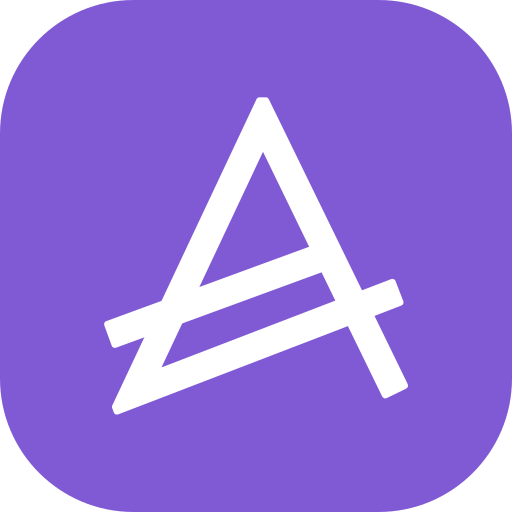 | [Actual Budget](./apps/actual-budget) | A simple tool to plan and track your money. |
|  | [AdGuard Home](./apps/adguardhome) | Blocks ads and trackers on your whole network. |
|  | [Anki](./apps/anki) | A sync server for your Anki flashcards. |
| 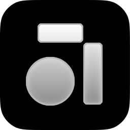 | [any-sync-bundle](./apps/any-sync-bundle) | A sync server for the Anytype app. |
|  | [Audiobookshelf](./apps/audiobookshelf) | A server for your audiobooks and podcasts. |
|  | [Authentik](./apps/authentik) | A login and single sign-on server. |
|  | [Beaver Habits](./apps/beaverhabits) | A simple habit tracker. |
|  | [Beszel](./apps/beszel) | Shows how busy your server is. |
|  | [Calibre-Web-Automated](./apps/calibre-web-automated) | Read and manage your ebook library in the browser. |
| 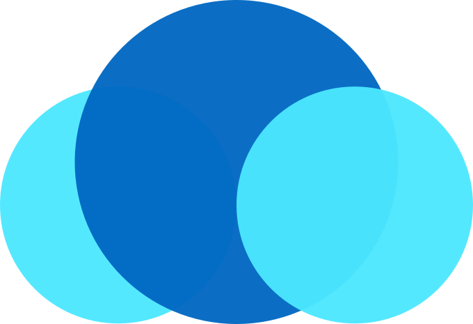 | [CasaOS](./apps/casa) | A home server dashboard. |
| 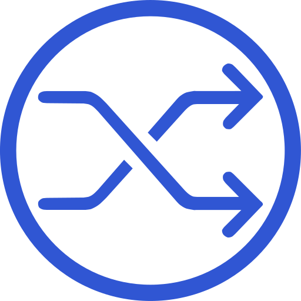 | [changedetection.io](./apps/changedetection) | Tells you when a web page changes. |
|  | [Collabora](./apps/collabora) | Edit documents in your browser. |
|  | [CookCLI](./apps/cookcli) | Keep your recipes as plain text files. |
|  | [Copyparty](./apps/copyparty) | A file server you can upload to from any device. |
| 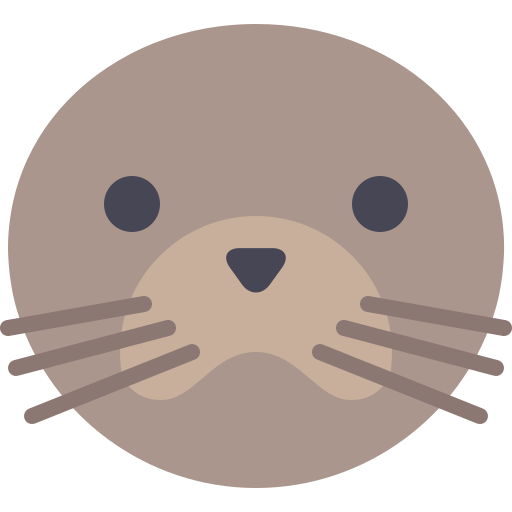 | [DocuSeal](./apps/docuseal) | Sign documents on your own server. |
| 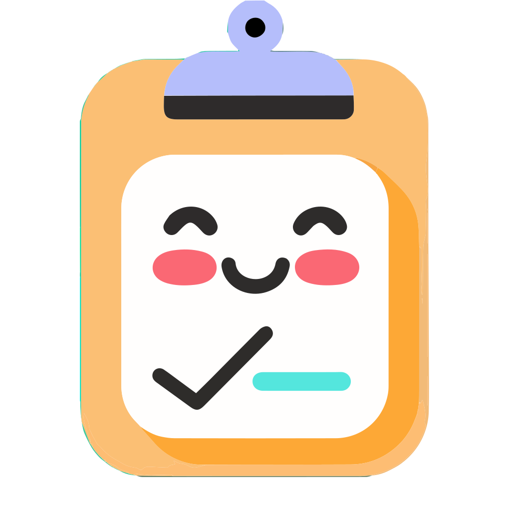 | [Donetick](./apps/donetick) | Keep track of household chores. |
|  | [Dozzle](./apps/dozzle) | Read your containers' logs in the browser. |
|  | [ExcaliDash](./apps/excalidash) | A place to organize and share Excalidraw drawings. |
|  | [Faved](./apps/faved) | A simple place to save bookmarks. |
|  | [Ferdium Server](./apps/ferdium-server) | A sync server for the Ferdium app. |
|  | [FileBrowser Quantum](./apps/filebrowser) | A file manager in your browser. |
|  | [FMD Server](./apps/fmd-server) | Find your Android phone from the browser. |
|  | [FreshRSS](./apps/freshrss) | Read all your news feeds in one place. |
|  | [Frigate](./apps/frigate) | A security camera recorder that spots people and objects. |
|  | [Ghost](./apps/ghost) | A blog and newsletter platform. |
|  | [Gitea](./apps/gitea) | A simple Git server for your code. |
|  | [Gitea Runner](./apps/gitea-runner) | Runs the automated workflows of your Gitea. |
|  | [Grafana](./apps/grafana) | Charts and dashboards for your data. |
|  | [Headscale](./apps/headscale) | Your own server for a private network. |
|  | [Hermes Agent](./apps/hermes-agent) | A personal AI assistant. |
| 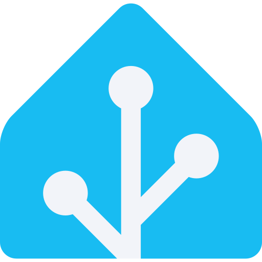 | [Home Assistant](./apps/home-assistant) | Control all your smart home devices in one place. |
| 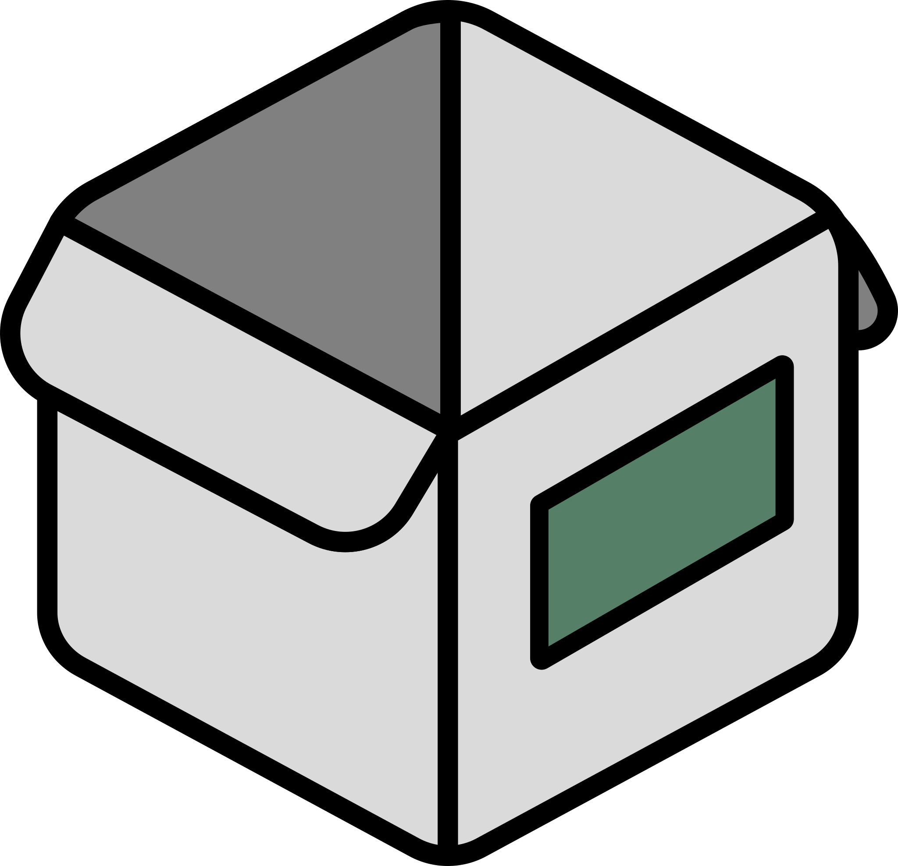 | [HomeBox](./apps/homebox) | Keep an inventory of everything you own. |
|  | [homepage](./apps/homepage) | A start page for your home server. |
|  | [Immich](./apps/immich) | Back up and browse your photos and videos. |
|  | [Instagram Monitor](./apps/instagram-monitor) | Watches Instagram profiles and shows their activity. |
|  | [Invio](./apps/invio) | Create and track invoices. |
|  | [Karakeep](./apps/karakeep) | Save and search your bookmarks. |
|  | [Karaoke Eternal](./apps/karaoke-eternal) | Run karaoke parties from your own songs. |
|  | [Kiwix](./apps/kiwix) | Read Wikipedia and other libraries offline. |
|  | [Koffan](./apps/koffan) | A shared shopping list. |
|  | [Komga](./apps/komga) | Read your comics and manga. |
|  | [LubeLogger](./apps/lubelogger) | Track maintenance for your vehicles. |
|  | [Mailpit](./apps/mailpit) | Catches the emails your apps send so you can read them. |
|  | [mdrop](./apps/mdrop) | Turn documents into Markdown. |
|  | [Media Stack](./apps/media-stack) | A media server and the tools that fill it. |
|  | [Memos](./apps/memos) | A simple place for quick notes. |
|  | [MeTube](./apps/metube) | Download videos from the web. |
|  | [Monica](./apps/monica) | Remember the people in your life. |
| 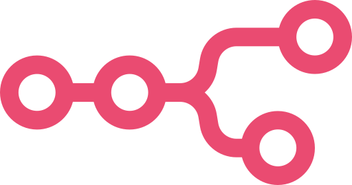 | [n8n](./apps/n8n) | Automate tasks between your apps. |
|  | [neko](./apps/neko) | A shared browser you can use together. |
|  | [netboot.xyz](./apps/netbootxyz) | Install an operating system over the network. |
| 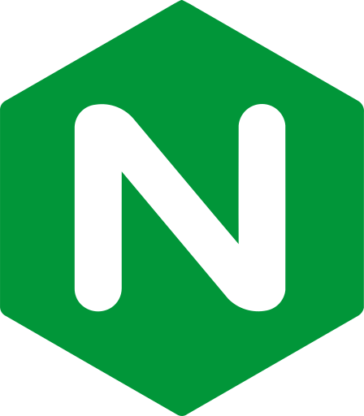 | [nginx](./apps/nginx) | A web server for static files. |
| 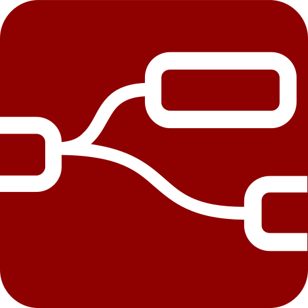 | [Node-RED](./apps/node-red) | Automate things by connecting blocks. |
| 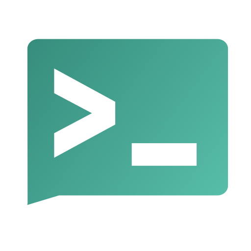 | [ntfy](./apps/ntfy) | Send notifications to your phone. |
|  | [Omni Tools](./apps/omni-tools) | Handy tools that run in your browser. |
|  | [Open WebUI](./apps/openwebui) | A chat interface for AI models. |
|  | [OpenWA](./apps/openwa) | Send WhatsApp messages from your other apps. |
|  | [ownCloud](./apps/owncloud) | Your own cloud for files. |
|  | [OwnTracks](./apps/owntracks) | Track your location from your phone. |
|  | [Paperless-ngx](./apps/paperless-ngx) | Scan and search your paper documents. |
|  | [PKVault](./apps/pkvault) | Manage your Pokémon save files. |
|  | [Postfix](./apps/postfix) | Sends email on behalf of your other apps. |
| 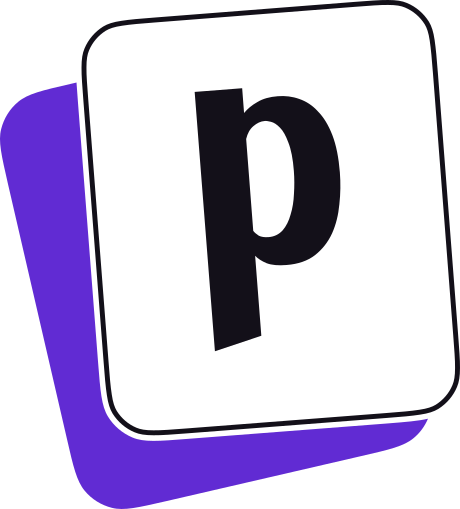 | [Postiz](./apps/postiz) | Schedule your social media posts. |
|  | [Prometheus](./apps/prometheus) | Collects numbers about how your services run. |
|  | [Proxmox VE](./apps/proxmox) | Try the Proxmox virtualization system. |
|  | [Radicale](./apps/radicale) | A calendar and contacts server. |
| 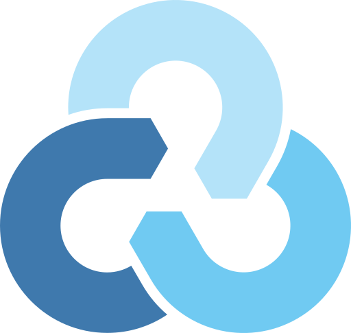 | [rclone](./apps/rclone) | Move files between your cloud accounts. |
|  | [Retrom](./apps/retrom) | A library for your retro games. |
|  | [SearXNG](./apps/searxng) | Search the web without being tracked. |
|  | [Stirling-PDF](./apps/stirling-pdf) | Edit and convert PDF files. |
|  | [Syncthing](./apps/syncthing) | Sync files between your devices. |
|  | [Toolbx](./apps/toolbx) | Throwaway Linux shells for trying things. |
|  | [Traccar](./apps/traccar) | Track vehicles and devices by GPS. |
|  | [tsdproxy](./apps/tsdproxy) | Puts your apps on your tailnet automatically. |
|  | [Uptime Kuma](./apps/uptime-kuma) | Tells you when a service goes down. |
|  | [Vaultwarden](./apps/vaultwarden) | A password manager you host yourself. |
|  | [VaultZap](./apps/vaultzap) | Browse your exported WhatsApp chats. |
| 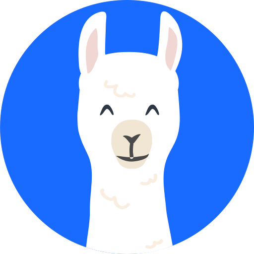 | [Vikunja](./apps/vikunja) | A to-do list for tasks and projects. |
|  | [VM](./apps/vm) | Run Windows, macOS and Linux in a container. |
| 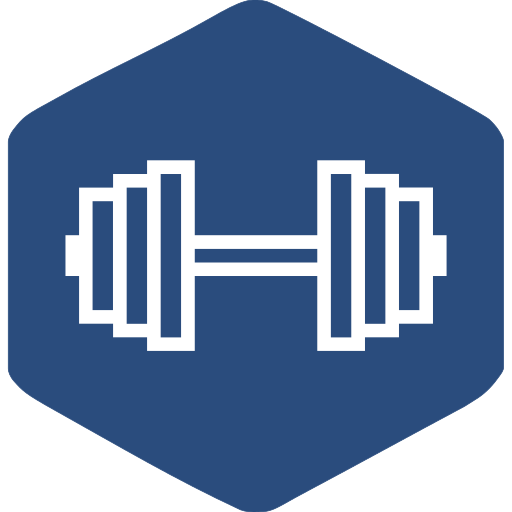 | [wger](./apps/wger) | Plan and track your workouts. |
| 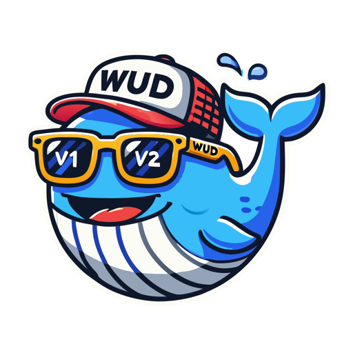 | [WUD (What's Up Docker)](./apps/wud) | Tells you when your containers have updates. |
|  | [Zabbix](./apps/zabbix) | Monitors your servers and network. |
|  | [Zerobyte](./apps/zerobyte) | Backs up your apps' data. |
|  | [Zigbee2MQTT](./apps/zigbee2mqtt) | Use Zigbee devices without the maker's hub. |

<!-- services:end -->

**Nothing updates on its own.** Every image is pinned — to a version, or to a
digest where upstream publishes none — and updated by hand; see
[auto-update](./docs/auto-update.md).

## The network: Tailscale, Headscale or local only

The tailnet is part of the project, and one choice (asked by `bootstrap.sh`, changed in the panel under
**Settings → Network**, or with `qh --network`) says which:

| Choice | What you get |
| --- | --- |
| **Local only** | No tailnet. The apps open on their LAN port, tsdproxy is stopped. The simplest way. |
| **Tailscale** | The host joins a [Tailscale](https://tailscale.com) tailnet and tsdproxy gives each service its own HTTPS name, reachable from anywhere without opening a port. Vaultwarden needs it: it only decrypts the session in a secure context. |
| **Headscale** | A network of your own, with no account at a third party: the project runs [Headscale](https://headscale.net) (the `headscale` app), and the host and tsdproxy sign in to it. Headscale issues no HTTPS certificate, so the apps are served over HTTP on the tailnet (WireGuard still encrypts it) and the ones that insist on HTTPS (Vaultwarden, Actual) need the Tailscale choice. |

```bash
qh --network                                   # where things stand
qh --network local --apply
qh --network tailscale --apply
qh --network headscale --tailnet <your-tailnet> --apply     # --login-server URL if not the LAN address
```

The part that needs root on the host is only shown, never run: Tailscale is a host package (it has to *be* the
host on the network), so the plan prints what is missing, once —

```bash
sudo transactional-update pkg install tailscale     # an immutable host; then reboot
sudo systemctl enable --now tailscaled
sudo tailscale set --operator=$USER                  # lets the panel sign the host in, without root
```

— and everything else (the login, the Headscale server, its user and key, tsdproxy's secret and `controlUrl`, the
`TAILNET` of the units, updating the apps) is the plan's steps. Under Tailscale, tsdproxy asks for a reusable auth
key from the admin console; under Headscale the project makes it. Switching changes the apps' proxied port label
(an update, which keeps the data) and is reversible: `--network local` then `--network tailscale` is the way
back.

Without a tailnet, `qh --network local` sets the rule and stops tsdproxy; the lower-level rule alone is still
`qh --set-access local`, which comments the `tsdproxy.*` labels out instead of deleting them.

## On an ARM server

Nearly every image here publishes an `arm64` variant and installs unchanged.
Three do not, and take their service with them:

| Image | Service |
| --- | --- |
| `dockurr/macos` | `vm-macos` |
| `dockurr/chromeos` | `vm-chromeos` |
| `quay.io/toolbx/arch-toolbox` | `toolbx-arch` |

For the VM services what decides is the guest, not the image: KVM only
accelerates a guest of the same architecture. `apps/vm` carries `vm-windows`
for x86_64 and `vm-windows-arm` for ARM64.

## Documentation

| | |
| --- | --- |
| [Installing and operating](./docs/installing.md) | install, update, back up, restore, remove |
| [Recovery and migration](./docs/recovery.md) | the machine died, or you are moving hosts |
| [Reference](./docs/reference.md) | where every file lives, and an annotated `.container` |
| [The app manifest](./docs/manifest.md) | `apps/<app>/app.json`: everything an app says about itself |
| [Auto-update](./docs/auto-update.md) | why nothing updates on its own |
| [Hardening, as measured](./docs/hardening.md) | what each image accepted, and the errors from what it refused |
| [Tools](./docs/tools.md) | `qh-check` and `qh-updates` |

All of it is also in Portuguese, in [`docs/pt-BR/`](./docs/pt-BR/).
