# Quadlet Homelab

**[🇺🇸 Read in English](../../README.md)**

83 serviços self-hosted como units do [Podman Quadlet](https://docs.podman.io/en/latest/markdown/podman-systemd.unit.5.html),
rootless, um serviço por pasta.

## Início rápido

```bash
curl -fsSL https://raw.githubusercontent.com/wallacepnts/quadlet-homelab/main/bootstrap.sh | bash
```

Debian e Ubuntu não trazem `curl` nem `wget` numa instalação crua — medido nas
imagens base dos dois. Ali você vai instalar pacote de qualquer forma, então
instale o `git`, que o bootstrap exige de toda maneira:

```bash
git clone https://github.com/wallacepnts/quadlet-homelab
bash quadlet-homelab/bootstrap.sh
```

Ele confere git/python3/podman e o `systemd --user`, cria as pastas do Podman,
clona o repositório em `~/quadlet-homelab`, liga as ferramentas em `~/.local/bin` e
**sobe o painel web** como um serviço `systemd --user` seu. Sem `sudo`, sem instalar
pacote. Pergunta uma vez de onde você vai abrir o painel (só desta máquina, da rede local
ou da tailnet) e termina mostrando o endereço e o token de login:

```
  painel no ar: http://127.0.0.1:8484
  login (o token): …
```

**Abra esse endereço num navegador: é assim que se usa isto.** O painel tem a Loja (os 83
serviços, por categoria, com capturas de tela) e Meus apps (o que está instalado, como um
lançador). Por ele você instala um app (só pergunta o que aquele app precisa, e deixa
personalizar portas, volumes e variáveis antes, ou experimentar por algumas horas), atualiza com
um botão, faz backup, restaura, muda as configurações, lê os logs ao vivo, abre um console no
container, pausa, para ou remove, e vê a carga, a memória e a temperatura do host. Cada botão
roda o mesmo motor `qh` que um terminal rodaria; nada no painel é uma segunda implementação.

Todo serviço fica acessível em `http://<ip-do-host>:<porta>` sem mais nada
configurado — sem domínio, sem certificado, sem mexer no roteador.

<details>
<summary>O terminal, se você preferir (avançado)</summary>

```bash
qh                   # os serviços
qh memos             # o plano de um, sem instalar
qh memos --apply     # fazer
```

[Instalar e operar](./instalacao.md) lista todos os modos.
</details>

## Atualizando

Duas coisas diferentes, nesta ordem.

**O repositório** — as units e as receitas. Rodar o mesmo comando de novo, ou
dar pull no clone; dá no mesmo:

```bash
curl -fsSL https://raw.githubusercontent.com/wallacepnts/quadlet-homelab/main/bootstrap.sh | bash
```

Ele avança o clone e cria os links que faltam — link que já aponta pra outro
clone ele nomeia, não move. Clone que divergiu é deixado em paz e avisado,
então edição local sua nunca é descartada.

**Os serviços no host** — nada se move até você mandar. No painel, um app com release
nova mostra o botão **Atualizar para X**, e Meus apps tem **Atualizar todos** para os que
têm algo a pegar (cada um reinicia; uma falha não interrompe os outros). Unit mais nova no
repositório não muda o arquivo já instalado. O mesmo, num terminal:

```bash
qh-updates                     # quais imagens estão atrás da release do upstream
qh memos --update --apply      # um serviço
qh --all --update --apply      # depois de uma leva de bumps
```

O `--update` recopia as units, puxa a imagem e reinicia. Não toca em volume,
`.env` nem secret. Serviço que já está em dia é pulado — e isso inclui o
container em execução, não só o arquivo: o Quadlet grava as labels na
criação, então uma unit certa no disco pode estar rodando num container com
as anteriores. Tag móvel (`latest`) é sempre puxada. Para passar por cima,
use `--reinstall`.

## Requisitos

- **Podman 5.0 ou mais novo.** É a régua de verdade: o `Notify=healthy` chegou
  nessa versão, e 117 das 125 units usam. No 4.x o start volta antes de o app
  estar pronto, e a instalação relata um sucesso que ela não tem como saber.
- **systemd com sessão de usuário** e cgroups v2.
- **`network-online.target` alcançado no boot.** O Quadlet ordena toda unit que
  gera atrás do `podman-user-wait-network-online.service`, que gira em
  `until systemctl is-active network-online.target` até o timeout de 90s. Um
  target só é ativado quando alguém o requer, e desktop muitas vezes não requer
  nada — medido no Tumbleweed com KDE, onde o único que pedia era um oneshot já
  terminado. A dependência é `Wants=`, então o serviço sobe: noventa segundos
  atrasado, em cada start.
  `sudo systemctl add-wants multi-user.target network-online.target` resolve, e
  o boot passa a esperar o `NetworkManager-wait-online` — segundos quando a
  máquina tem rede, `NM_ONLINE_TIMEOUT` quando não tem.
- **SELinux**, se a sua distribuição tiver. As units trazem `:Z` em 125 linhas
  de volume; onde não há SELinux elas são ignoradas e nada quebra, mas o
  isolamento por container que elas pedem também não existe. As seis units que
  montam o socket do Podman precisam de mais que rótulo — só `:z` as deixa
  saudáveis e cegas, sem enxergar container nenhum, então elas declaram
  `SecurityLabelType=container_runtime_t` (regra 16 das convenções).
- `/dev/kvm` para os seis serviços de VM, e `/dev/net/tun` para esses mais o
  gluetun. Os dois são `0666` numa instalação usual, então o rootless os
  alcança sem mudar grupo nenhum.
- `/dev/dri`, só para o `vm-chromeos`, que repassa a GPU do host. Esse é
  `0660 root:render`, e funciona sem você entrar nesse grupo apenas porque o
  logind põe uma ACL nele para a **sessão ativa**. Um host headless rodando
  com `enable-linger` e sem seat pode não ter essa ACL, e o sintoma é um
  container que sobe e renderiza por software. Confira com
  `getfacl /dev/dri/renderD128` antes de culpar a imagem.

```bash
podman --version
systemctl is-active network-online.target
```

Medido, instalando o podman em cada uma e lendo a versão:

| Distribuição | Podman | |
| --- | --- | --- |
| Arch | 6.0.2 | funciona |
| openSUSE Tumbleweed, Slowroll | 6.0.2 | funciona |
| openSUSE MicroOS, Aeon, Kalpa | 5.8 | funciona |
| Fedora 42 | 5.8.2 | funciona |
| Debian 13 | 5.4.2 | funciona |
| openSUSE Leap 16.0 | 5.4.2 | funciona |
| Ubuntu 25.04 | 5.4.1 | funciona |
| Ubuntu 24.04 LTS | 4.9.3 | **antiga demais** |
| openSUSE Leap 15.6 | 4.9.5 | **antiga demais** |
| Debian 12 | 4.3.1 | **antiga demais** |

Aeon e Kalpa são MicroOS com desktop e compartilham os repositórios dele. O
Leap Micro segue a geração do Leap que o originou, então a linha 5.x herda o
problema do Leap 15 — ele não publica imagem de container e não foi medido
aqui.

## Serviços

<!-- services:begin (generated from apps/*/app.json: python3 check.py --readme) -->

| Logo | Aplicativo | Descrição |
| --- | --- | --- |
|  | [Actual Budget](../../apps/actual-budget) | Rápido e focado em privacidade pra gerenciar finanças pessoais, usando a metodologia de Orçamento de Envelope |
|  | [AdGuard Home](../../apps/adguardhome) | Servidor DNS recursivo com bloqueio de anúncios e rastreadores pra toda a rede |
|  | [Anki](../../apps/anki) | O servidor de sincronização do próprio Anki, para cartões, revisões e mídia sincronizarem sem o AnkiWeb |
|  | [any-sync-bundle](../../apps/any-sync-bundle) | Backend do protocolo Any-Sync, que sincroniza os dados do Anytype entre dispositivos sem depender da nuvem da empresa |
|  | [Audiobookshelf](../../apps/audiobookshelf) | Servidor de audiolivros e podcasts, com progresso sincronizado entre dispositivos |
|  | [Authentik](../../apps/authentik) | Servidor de identidade (SSO, MFA, OIDC/SAML) — só o core implantado, sem forward-auth via tsdproxy ainda (veja as notas dele no painel) |
|  | [Beaver Habits](../../apps/beaverhabits) | Acompanhamento de hábitos sem metas e sem cobrança de sequência — você marca o dia e segue |
|  | [Beszel](../../apps/beszel) | Dashboard leve de monitoramento de recursos (CPU/RAM/disco/rede/containers) deste host |
|  | [Calibre-Web-Automated](../../apps/calibre-web-automated) | Biblioteca de ebooks com conversão, metadados e capas automáticas via Calibre, com leitura direto no navegador |
| 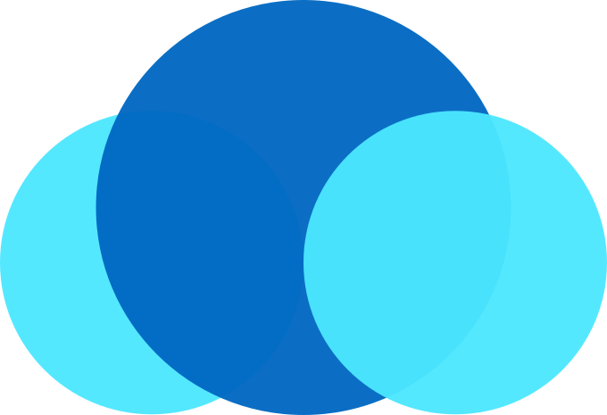 | [CasaOS](../../apps/casa) | Painel de servidor doméstico que fala com o socket do Podman — enxerga todos os containers que você roda; instalar apps pela loja dele não funcionou aqui |
| 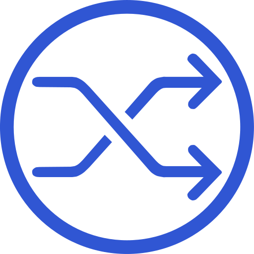 | [changedetection.io](../../apps/changedetection) | Vigia páginas e avisa o que mudou — preço, estoque, um parágrafo de termos de uso |
|  | [Collabora](../../apps/collabora) | Edição de documentos dentro do ownCloud — texto, planilha e slides, no navegador |
|  | [CookCLI](../../apps/cookcli) | Receitas em texto puro no formato CookLang — versionáveis em git, sem banco e sem formulário |
|  | [Copyparty](../../apps/copyparty) | Servidor de arquivos com upload pelo navegador ou celular, retomada de transferência e WebDAV |
|  | [DocuSeal](../../apps/docuseal) | Assinar documentos em casa, sem entregá-los a uma empresa antes |
|  | [Donetick](../../apps/donetick) | Tarefas domésticas recorrentes — quem faz, com que frequência e quando vence |
|  | [Dozzle](../../apps/dozzle) | Log ao vivo de cada container no navegador, sem abrir terminal |
| 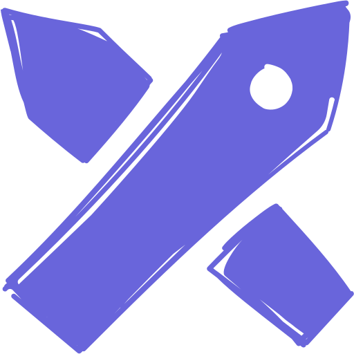 | [ExcaliDash](../../apps/excalidash) | Painel para desenhos do Excalidraw — pastas, compartilhamento e multiusuário, no seu armazenamento |
|  | [Faved](../../apps/faved) | Favoritos com tags aninhadas — prateleira mais leve que um arquivador, no seu servidor |
|  | [Ferdium Server](../../apps/ferdium-server) | Sincronização do Ferdium desktop — sua lista de serviços no seu servidor, não no do Franz |
|  | [FileBrowser Quantum](../../apps/filebrowser) | Gerenciador de arquivos web — busca, miniaturas, WebDAV e um shell sobre um diretório que você escolhe |
|  | [FMD Server](../../apps/fmd-server) | Localizar, tocar e bloquear seu celular Android pelo navegador, com criptografia ponta a ponta, sem o Google |
|  | [FreshRSS](../../apps/freshrss) | Agregador de feeds RSS/Atom self-hosted, com API compatível pra apps móveis |
|  | [Frigate](../../apps/frigate) | NVR com detecção de objetos por IA — CPU-only por padrão, sem câmera configurada ainda (veja as notas dele no painel) |
|  | [Ghost](../../apps/ghost) | Blog/newsletter self-hosted (SQLite, modo development — ver README) |
|  | [Gitea](../../apps/gitea) | Servidor Git leve e completo — repositórios, issues, pull requests e CI numa interface só |
|  | [Gitea Runner](../../apps/gitea-runner) | Executa os workflows do Actions do Gitea ao lado — CI que não sai da máquina |
|  | [Grafana](../../apps/grafana) | Painéis sobre o que você apontar — ele não traz dado nenhum próprio |
|  | [Hermes Agent](../../apps/hermes-agent) | Agente de IA pessoal com habilidades e memória, expondo uma API compatível com a da OpenAI pros outros serviços chamarem |
| 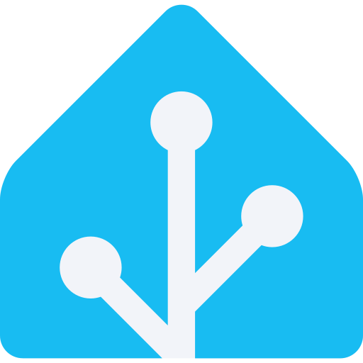 | [Home Assistant](../../apps/home-assistant) | Hub central de automação residencial, integra dispositivos de qualquer fabricante num painel só |
|  | [HomeBox](../../apps/homebox) | Inventário doméstico — o que você tem, onde está, nota fiscal, manual e garantia, com busca e etiquetas |
|  | [homepage](../../apps/homepage) | Dashboard que descobre e organiza os outros containers sozinho via labels, sem editar config a cada serviço novo |
|  | [Immich](../../apps/immich) | Backup e organização de fotos/vídeos, com reconhecimento facial e busca smart |
|  | [Instagram Monitor](../../apps/instagram-monitor) | Monitor OSINT de Instagram em tempo real com dashboard web, feed de atividade e download de mídia |
|  | [Invio](../../apps/invio) | Emissão e controle de faturas self-hosted, com SQLite e sem depender de serviço externo |
|  | [Karakeep](../../apps/karakeep) | Gerenciador de bookmarks com busca full-text e arquivamento automático do conteúdo de cada página salva |
|  | [Karaoke Eternal](../../apps/karaoke-eternal) | Karaokê com a sua própria biblioteca — cada um enfileira do celular, uma tela reproduz |
|  | [Kiwix](../../apps/kiwix) | Wikipedia e outras bibliotecas servidas do disco, para ler com a internet desligada |
|  | [Koffan](../../apps/koffan) | A lista de compras da casa — uma senha, sem contas, todo mundo edita a mesma lista |
|  | [Komga](../../apps/komga) | Quadrinhos e mangá, com o progresso de leitura acompanhando você entre aparelhos |
|  | [LubeLogger](../../apps/lubelogger) | Registro de manutenção veicular — trocas de óleo, revisões, gastos e lembretes, por veículo |
|  | [Mailpit](../../apps/mailpit) | Servidor SMTP que captura tudo que seus apps enviam, para ler no navegador em vez de numa caixa de entrada de verdade |
|  | [mdrop](../../apps/mdrop) | Converte PDF, Office, imagem e áudio para Markdown pela web, sem estado e sem sair da máquina |
|  | [Media Stack](../../apps/media-stack) | Jellyfin, Navidrome, Seerr, Prowlarr, Sonarr, Radarr, Lidarr, Bazarr, SABnzbd, Deluge, Dispatcharr, Downtify e um Gluetun opcional — servidor de mídia + automação, raiz de dados compartilhada, cada app com sua própria versão |
|  | [Memos](../../apps/memos) | Notas rápidas, self-hosted e markdown-nativo |
|  | [MeTube](../../apps/metube) | Interface web do yt-dlp — cola a URL e o vídeo cai no disco |
|  | [Monica](../../apps/monica) | CRM pessoal — histórico de relacionamentos, contatos, lembretes |
|  | [n8n](../../apps/n8n) | Automação de workflows via editor visual de nós |
|  | [neko](../../apps/neko) | Um navegador rodando no servidor, transmitido para o seu — controle compartilhado, e nada do que ele abre toca a sua máquina |
|  | [netboot.xyz](../../apps/netbootxyz) | Menu de boot pela rede (PXE) pra instalar ou testar distros e ferramentas sem gravar pendrive |
| 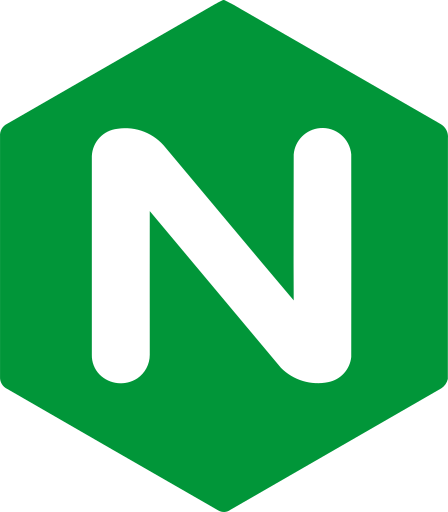 | [nginx](../../apps/nginx) | Servidor de arquivos estáticos |
| 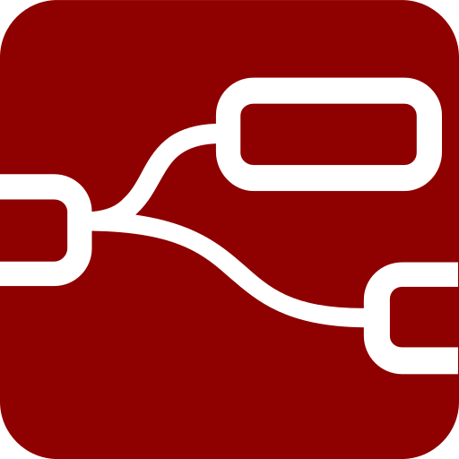 | [Node-RED](../../apps/node-red) | Automação de fluxos via editor visual de nós |
|  | [ntfy](../../apps/ntfy) | Servidor de notificações push — destino dos alertas do uptime-kuma, wud e zerobyte, com app no celular |
|  | [Omni Tools](../../apps/omni-tools) | Conversores, geradores e calculadoras que rodam no navegador — nada é enviado ao servidor |
|  | [Open WebUI](../../apps/openwebui) | Interface de chat web + servidor de LLMs locais, CPU-only por padrão (opções de GPU NVIDIA/AMD documentadas) |
|  | [OpenWA](../../apps/openwa) | Gateway de API do WhatsApp — transforma a conta em REST + webhooks, pro n8n e o Home Assistant usarem |
|  | [ownCloud](../../apps/owncloud) | Sincronização e compartilhamento de arquivos em nuvem própria |
|  | [OwnTracks](../../apps/owntracks) | Rastreamento de localização pessoal via app de celular, com broker MQTT próprio e histórico de posições |
|  | [Paperless-ngx](../../apps/paperless-ngx) | Digitaliza, faz OCR e indexa documentos automaticamente, com busca full-text pra nunca mais procurar papel |
|  | [PKVault](../../apps/pkvault) | Armazenamento de Pokémon e edição de saves de todas as gerações, baseado no PKHeX, com uma Pokédex montada a partir de todos os seus saves |
|  | [Postfix](../../apps/postfix) | Relay SMTP para os outros containers — eles entregam num lugar só, e a credencial do provedor fica só aqui |
| 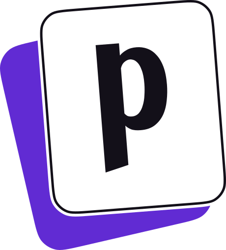 | [Postiz](../../apps/postiz) | Agenda posts no Instagram e em outras redes sociais, com calendário e um só lugar para todos os canais |
|  | [Prometheus](../../apps/prometheus) | Coleta métricas em intervalo e guarda o histórico — a fonte de dados que o Grafana desenha |
| 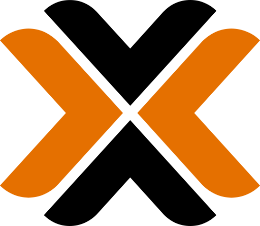 | [Proxmox VE](../../apps/proxmox) | O hypervisor Proxmox num container, pra experimentar sem dedicar uma máquina — roda privileged |
|  | [Radicale](../../apps/radicale) | Servidor CalDAV/CardDAV leve e minimalista, no rebuild que traz o script do calendário de aniversários (Radicale 3.7.6.0 dentro) |
|  | [rclone](../../apps/rclone) | Interface web para as contas de nuvem do seu config do rclone: navegar, copiar e sincronizar arquivos entre elas |
|  | [Retrom](../../apps/retrom) | Biblioteca de jogos para emulação — uma coleção só, jogada no navegador ou pelo cliente de desktop |
|  | [SearXNG](../../apps/searxng) | Metabusca que consulta dezenas de motores de uma vez, sem guardar perfil seu |
|  | [Stirling-PDF](../../apps/stirling-pdf) | Manipulação de PDF local — juntar, dividir, converter, OCR e assinar, no lugar dos sites de "PDF online" |
|  | [Syncthing](../../apps/syncthing) | Sincronização de arquivos P2P entre dispositivos, sem servidor central |
|  | [Toolbx](../../apps/toolbx) | Shells descartáveis de Arch, Fedora, RHEL e Ubuntu, nas imagens oficiais do Toolbx — um lugar pra instalar ferramenta avulsa que não é o host |
|  | [Traccar](../../apps/traccar) | Rastreamento de GPS — mapa ao vivo, histórico, geocercas e relatórios, com app no celular |
|  | [tsdproxy](../../apps/tsdproxy) | Publica containers na tailnet automaticamente, só com labels — sem configurar proxy manualmente por serviço |
|  | [Uptime Kuma](../../apps/uptime-kuma) | Monitor de disponibilidade dos outros serviços e da tailnet, com histórico e notificação |
|  | [Vaultwarden](../../apps/vaultwarden) | Cofre de senhas compatível com o protocolo do Bitwarden, leve o bastante pra rodar em qualquer lugar |
|  | [VaultZap](../../apps/vaultzap) | Arquivo local e navegável de conversas exportadas do WhatsApp — busca, galeria e calendário, 100% offline |
| 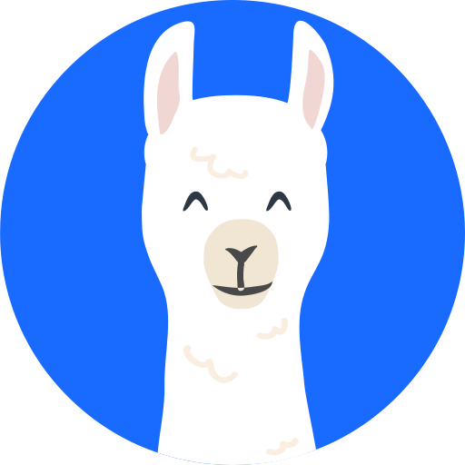 | [Vikunja](../../apps/vikunja) | Tarefas com prazo e projeto por trás, em lista, kanban ou gantt |
|  | [VM](../../apps/vm) | Windows, macOS, ChromeOS Flex, ZimaOS e 23 distros Linux como VMs em containers, vistas pelo navegador — exige KVM no host |
| 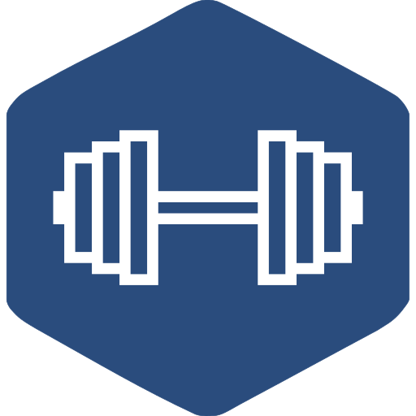 | [wger](../../apps/wger) | Planejamento e acompanhamento de treinos, com banco de exercícios e medidas corporais |
| 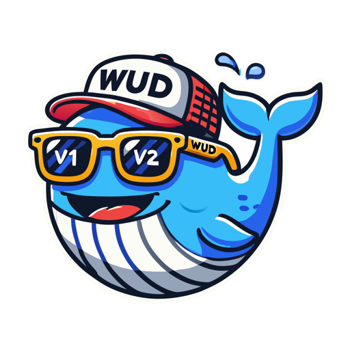 | [WUD (What's Up Docker)](../../apps/wud) | Monitora as atualizações de imagem disponíveis pros containers, sem aplicar nada sozinho — só avisa |
|  | [Zabbix](../../apps/zabbix) | Monitoramento de servidores, redes e serviços com agentes, SNMP, triggers e alertas — server, interface web e PostgreSQL |
|  | [Zerobyte](../../apps/zerobyte) | Automatiza backup (via Restic) dos dados de todos os outros serviços deste repositório |
|  | [Zigbee2MQTT](../../apps/zigbee2mqtt) | Ponte entre dispositivos Zigbee e MQTT, sem hub proprietário — sem coordenador ligado ainda (veja as notas dele no painel) |

<!-- services:end -->

**Nada atualiza sozinho.** Toda imagem é fixada — numa versão, ou num digest
onde o projeto não publica versão — e atualizada na mão; ver
[auto-update](./auto-update.md).

## Opcional: a tailnet

O [Tailscale](https://tailscale.com) com o tsdproxy dá a cada serviço um nome
HTTPS próprio, alcançável de qualquer lugar sem abrir porta. O Vaultwarden
precisa disso — ele só decifra a sessão em contexto seguro.

O `qh tailscale` confere os três passos abaixo no host e mostra só o que
falta.

Instalar o Tailscale pela sua distribuição (ver
[tailscale.com/download](https://tailscale.com/download)) e depois:

```bash
sudo systemctl enable --now tailscaled
sudo tailscale up

mkdir -p ~/.config/environment.d
echo 'TAILNET=<your-tailnet>' > ~/.config/environment.d/tailnet.conf
systemctl --user daemon-reload

qh tsdproxy --apply
```

Sem tailnet, defina a regra uma vez e toda instalação a segue:

```bash
qh --set-access local
```

Ele comenta as labels `tsdproxy.*` em vez de apagá-las. Ligar depois é uma atualização, que preserva
os dados:

```bash
qh --all --update --apply --access tailnet
```

## Num servidor ARM

Quase toda imagem aqui publica variante `arm64` e instala sem mudança. Três
não publicam, e levam o serviço junto:

| Imagem | Serviço |
| --- | --- |
| `dockurr/macos` | `vm-macos` |
| `dockurr/chromeos` | `vm-chromeos` |
| `quay.io/toolbx/arch-toolbox` | `toolbx-arch` |

Nos serviços de VM quem decide é o convidado, não a imagem: o KVM só acelera
convidado da mesma arquitetura. O `apps/vm` traz `vm-windows` pra x86_64 e
`vm-windows-arm` pra ARM64.

## Documentação

| | |
| --- | --- |
| [Instalando e operando](./instalacao.md) | instalar, atualizar, backup, restaurar, remover |
| [Recuperação e migração](./recuperacao.md) | a máquina morreu, ou você está mudando de host |
| [Referência](./referencia.md) | onde cada arquivo mora, e um `.container` anotado |
| [O manifesto do app](./manifesto.md) | `apps/<app>/app.json`: tudo o que um app diz de si mesmo |
| [Auto-update](./auto-update.md) | por que nada atualiza sozinho |
| [Endurecimento, o que foi medido](./endurecimento.md) | o que cada imagem aceitou, e os erros do que ela recusou |
| [Ferramentas](./ferramentas.md) | `qh-check` e `qh-updates` |
