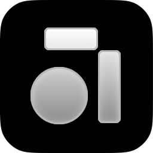

# Quadlet Homelab

**[🇺🇸 Read in English](../../README.md)**

83 serviços self-hosted como units do [Podman Quadlet](https://docs.podman.io/en/latest/markdown/podman-systemd.unit.5.html),
rootless, um serviço por pasta.

## Início rápido

```bash
curl -fsSL https://raw.githubusercontent.com/wallacepnts/quadlet-homelab/main/bootstrap.sh | bash
```

Debian e Ubuntu não trazem `curl` nem `wget` numa instalação crua — medido nas
imagens base dos dois. Ali você vai instalar pacote de qualquer forma, então
instale o `git`, que o bootstrap exige de toda maneira:

```bash
git clone https://github.com/wallacepnts/quadlet-homelab
bash quadlet-homelab/bootstrap.sh
```

Ele confere git/python3/podman e o `systemd --user`, cria as pastas do Podman,
clona o repositório em `~/quadlet-homelab`, liga as ferramentas em `~/.local/bin` e
**sobe o painel web** como um serviço `systemd --user` seu. Sem `sudo`, sem instalar
pacote. Pergunta uma vez de onde você vai abrir o painel (só desta máquina, da rede local
ou da tailnet) e termina mostrando o endereço e o token de login:

```
  painel no ar: http://127.0.0.1:8484
  login (o token): …
```

**Abra esse endereço num navegador: é assim que se usa isto.** O painel tem a Loja (os 83
serviços, por categoria, com capturas de tela) e Meus apps (o que está instalado, como um
lançador). Por ele você instala um app (só pergunta o que aquele app precisa, e deixa
personalizar portas, volumes e variáveis antes, ou experimentar por algumas horas), atualiza com
um botão, faz backup, restaura, muda as configurações, lê os logs ao vivo, abre um console no
container, pausa, para ou remove, e vê a carga, a memória e a temperatura do host. Cada botão
roda o mesmo motor `qh` que um terminal rodaria; nada no painel é uma segunda implementação.

Todo serviço fica acessível em `http://<ip-do-host>:<porta>` sem mais nada
configurado — sem domínio, sem certificado, sem mexer no roteador.

<details>
<summary>O terminal, se você preferir (avançado)</summary>

```bash
qh                   # os serviços
qh memos             # o plano de um, sem instalar
qh memos --apply     # fazer
```

[Instalar e operar](./instalacao.md) lista todos os modos.
</details>

## Atualizando

Duas coisas diferentes, nesta ordem.

**O repositório** — as units e as receitas. Rodar o mesmo comando de novo, ou
dar pull no clone; dá no mesmo:

```bash
curl -fsSL https://raw.githubusercontent.com/wallacepnts/quadlet-homelab/main/bootstrap.sh | bash
```

Ele avança o clone e cria os links que faltam — link que já aponta pra outro
clone ele nomeia, não move. Clone que divergiu é deixado em paz e avisado,
então edição local sua nunca é descartada.

**Os serviços no host** — nada se move até você mandar. No painel, um app com release
nova mostra o botão **Atualizar para X**, e Meus apps tem **Atualizar todos** para os que
têm algo a pegar (cada um reinicia; uma falha não interrompe os outros). Unit mais nova no
repositório não muda o arquivo já instalado. O mesmo, num terminal:

```bash
qh-updates                     # quais imagens estão atrás da release do upstream
qh memos --update --apply      # um serviço
qh --all --update --apply      # depois de uma leva de bumps
```

O `--update` recopia as units, puxa a imagem e reinicia. Não toca em volume,
`.env` nem secret. Serviço que já está em dia é pulado — e isso inclui o
container em execução, não só o arquivo: o Quadlet grava as labels na
criação, então uma unit certa no disco pode estar rodando num container com
as anteriores. Tag móvel (`latest`) é sempre puxada. Para passar por cima,
use `--reinstall`.

## Requisitos

- **Podman 5.0 ou mais novo.** É a régua de verdade: o `Notify=healthy` chegou
  nessa versão, e 117 das 125 units usam. No 4.x o start volta antes de o app
  estar pronto, e a instalação relata um sucesso que ela não tem como saber.
- **systemd com sessão de usuário** e cgroups v2.
- **`network-online.target` alcançado no boot.** O Quadlet ordena toda unit que
  gera atrás do `podman-user-wait-network-online.service`, que gira em
  `until systemctl is-active network-online.target` até o timeout de 90s. Um
  target só é ativado quando alguém o requer, e desktop muitas vezes não requer
  nada — medido no Tumbleweed com KDE, onde o único que pedia era um oneshot já
  terminado. A dependência é `Wants=`, então o serviço sobe: noventa segundos
  atrasado, em cada start.
  `sudo systemctl add-wants multi-user.target network-online.target` resolve, e
  o boot passa a esperar o `NetworkManager-wait-online` — segundos quando a
  máquina tem rede, `NM_ONLINE_TIMEOUT` quando não tem.
- **SELinux**, se a sua distribuição tiver. As units trazem `:Z` em 125 linhas
  de volume; onde não há SELinux elas são ignoradas e nada quebra, mas o
  isolamento por container que elas pedem também não existe. As seis units que
  montam o socket do Podman precisam de mais que rótulo — só `:z` as deixa
  saudáveis e cegas, sem enxergar container nenhum, então elas declaram
  `SecurityLabelType=container_runtime_t` (regra 16 das convenções).
- `/dev/kvm` para os seis serviços de VM, e `/dev/net/tun` para esses mais o
  gluetun. Os dois são `0666` numa instalação usual, então o rootless os
  alcança sem mudar grupo nenhum.
- `/dev/dri`, só para o `vm-chromeos`, que repassa a GPU do host. Esse é
  `0660 root:render`, e funciona sem você entrar nesse grupo apenas porque o
  logind põe uma ACL nele para a **sessão ativa**. Um host headless rodando
  com `enable-linger` e sem seat pode não ter essa ACL, e o sintoma é um
  container que sobe e renderiza por software. Confira com
  `getfacl /dev/dri/renderD128` antes de culpar a imagem.

```bash
podman --version
systemctl is-active network-online.target
```

Medido, instalando o podman em cada uma e lendo a versão:

| Distribuição | Podman | |
| --- | --- | --- |
| Arch | 6.0.2 | funciona |
| openSUSE Tumbleweed, Slowroll | 6.0.2 | funciona |
| openSUSE MicroOS, Aeon, Kalpa | 5.8 | funciona |
| Fedora 42 | 5.8.2 | funciona |
| Debian 13 | 5.4.2 | funciona |
| openSUSE Leap 16.0 | 5.4.2 | funciona |
| Ubuntu 25.04 | 5.4.1 | funciona |
| Ubuntu 24.04 LTS | 4.9.3 | **antiga demais** |
| openSUSE Leap 15.6 | 4.9.5 | **antiga demais** |
| Debian 12 | 4.3.1 | **antiga demais** |

Aeon e Kalpa são MicroOS com desktop e compartilham os repositórios dele. O
Leap Micro segue a geração do Leap que o originou, então a linha 5.x herda o
problema do Leap 15 — ele não publica imagem de container e não foi medido
aqui.

## Serviços

<!-- services:begin (generated from apps/*/app.json: python3 check.py --readme) -->

| Logo | Aplicativo | Descrição |
| --- | --- | --- |
|  | [Actual Budget](../../apps/actual-budget) | A simple tool to plan and track your money. |
|  | [AdGuard Home](../../apps/adguardhome) | Blocks ads and trackers on your whole network. |
|  | [Anki](../../apps/anki) | A sync server for your Anki flashcards. |
|  | [any-sync-bundle](../../apps/any-sync-bundle) | A sync server for the Anytype app. |
|  | [Audiobookshelf](../../apps/audiobookshelf) | A server for your audiobooks and podcasts. |
|  | [Authentik](../../apps/authentik) | A login and single sign-on server. |
|  | [Beaver Habits](../../apps/beaverhabits) | A simple habit tracker. |
|  | [Beszel](../../apps/beszel) | Shows how busy your server is. |
|  | [Calibre-Web-Automated](../../apps/calibre-web-automated) | Read and manage your ebook library in the browser. |
|  | [CasaOS](../../apps/casa) | A home server dashboard. |
|  | [changedetection.io](../../apps/changedetection) | Tells you when a web page changes. |
|  | [Collabora](../../apps/collabora) | Edit documents in your browser. |
|  | [CookCLI](../../apps/cookcli) | Keep your recipes as plain text files. |
|  | [Copyparty](../../apps/copyparty) | A file server you can upload to from any device. |
|  | [DocuSeal](../../apps/docuseal) | Sign documents on your own server. |
|  | [Donetick](../../apps/donetick) | Keep track of household chores. |
|  | [Dozzle](../../apps/dozzle) | Read your containers' logs in the browser. |
|  | [ExcaliDash](../../apps/excalidash) | A place to organize and share Excalidraw drawings. |
|  | [Faved](../../apps/faved) | A simple place to save bookmarks. |
|  | [Ferdium Server](../../apps/ferdium-server) | A sync server for the Ferdium app. |
|  | [FileBrowser Quantum](../../apps/filebrowser) | A file manager in your browser. |
|  | [FMD Server](../../apps/fmd-server) | Find your Android phone from the browser. |
|  | [FreshRSS](../../apps/freshrss) | Read all your news feeds in one place. |
|  | [Frigate](../../apps/frigate) | A security camera recorder that spots people and objects. |
|  | [Ghost](../../apps/ghost) | A blog and newsletter platform. |
|  | [Gitea](../../apps/gitea) | A simple Git server for your code. |
|  | [Gitea Runner](../../apps/gitea-runner) | Runs the automated workflows of your Gitea. |
|  | [Grafana](../../apps/grafana) | Charts and dashboards for your data. |
|  | [Hermes Agent](../../apps/hermes-agent) | A personal AI assistant. |
|  | [Home Assistant](../../apps/home-assistant) | Control all your smart home devices in one place. |
|  | [HomeBox](../../apps/homebox) | Keep an inventory of everything you own. |
|  | [homepage](../../apps/homepage) | A start page for your home server. |
|  | [Immich](../../apps/immich) | Back up and browse your photos and videos. |
|  | [Instagram Monitor](../../apps/instagram-monitor) | Watches Instagram profiles and shows their activity. |
|  | [Invio](../../apps/invio) | Create and track invoices. |
|  | [Karakeep](../../apps/karakeep) | Save and search your bookmarks. |
|  | [Karaoke Eternal](../../apps/karaoke-eternal) | Run karaoke parties from your own songs. |
|  | [Kiwix](../../apps/kiwix) | Read Wikipedia and other libraries offline. |
|  | [Koffan](../../apps/koffan) | A shared shopping list. |
|  | [Komga](../../apps/komga) | Read your comics and manga. |
|  | [LubeLogger](../../apps/lubelogger) | Track maintenance for your vehicles. |
|  | [Mailpit](../../apps/mailpit) | Catches the emails your apps send so you can read them. |
|  | [mdrop](../../apps/mdrop) | Turn documents into Markdown. |
|  | [Media Stack](../../apps/media-stack) | A media server and the tools that fill it. |
|  | [Memos](../../apps/memos) | A simple place for quick notes. |
|  | [MeTube](../../apps/metube) | Download videos from the web. |
|  | [Monica](../../apps/monica) | Remember the people in your life. |
|  | [n8n](../../apps/n8n) | Automate tasks between your apps. |
|  | [neko](../../apps/neko) | A shared browser you can use together. |
|  | [netboot.xyz](../../apps/netbootxyz) | Install an operating system over the network. |
|  | [nginx](../../apps/nginx) | A web server for static files. |
|  | [Node-RED](../../apps/node-red) | Automate things by connecting blocks. |
|  | [ntfy](../../apps/ntfy) | Send notifications to your phone. |
|  | [Omni Tools](../../apps/omni-tools) | Handy tools that run in your browser. |
|  | [Open WebUI](../../apps/openwebui) | A chat interface for AI models. |
|  | [OpenWA](../../apps/openwa) | Send WhatsApp messages from your other apps. |
|  | [ownCloud](../../apps/owncloud) | Your own cloud for files. |
|  | [OwnTracks](../../apps/owntracks) | Track your location from your phone. |
|  | [Paperless-ngx](../../apps/paperless-ngx) | Scan and search your paper documents. |
|  | [PKVault](../../apps/pkvault) | Manage your Pokémon save files. |
|  | [Postfix](../../apps/postfix) | Sends email on behalf of your other apps. |
|  | [Postiz](../../apps/postiz) | Schedule your social media posts. |
|  | [Prometheus](../../apps/prometheus) | Collects numbers about how your services run. |
|  | [Proxmox VE](../../apps/proxmox) | Try the Proxmox virtualization system. |
|  | [Radicale](../../apps/radicale) | A calendar and contacts server. |
|  | [rclone](../../apps/rclone) | Move files between your cloud accounts. |
|  | [Retrom](../../apps/retrom) | A library for your retro games. |
|  | [SearXNG](../../apps/searxng) | Search the web without being tracked. |
|  | [Stirling-PDF](../../apps/stirling-pdf) | Edit and convert PDF files. |
|  | [Syncthing](../../apps/syncthing) | Sync files between your devices. |
|  | [Toolbx](../../apps/toolbx) | Throwaway Linux shells for trying things. |
|  | [Traccar](../../apps/traccar) | Track vehicles and devices by GPS. |
|  | [tsdproxy](../../apps/tsdproxy) | Puts your apps on your tailnet automatically. |
|  | [Uptime Kuma](../../apps/uptime-kuma) | Tells you when a service goes down. |
|  | [Vaultwarden](../../apps/vaultwarden) | A password manager you host yourself. |
|  | [VaultZap](../../apps/vaultzap) | Browse your exported WhatsApp chats. |
|  | [Vikunja](../../apps/vikunja) | A to-do list for tasks and projects. |
|  | [VM](../../apps/vm) | Run Windows, macOS and Linux in a container. |
|  | [wger](../../apps/wger) | Plan and track your workouts. |
|  | [WUD (What's Up Docker)](../../apps/wud) | Tells you when your containers have updates. |
|  | [Zabbix](../../apps/zabbix) | Monitors your servers and network. |
|  | [Zerobyte](../../apps/zerobyte) | Backs up your apps' data. |
|  | [Zigbee2MQTT](../../apps/zigbee2mqtt) | Use Zigbee devices without the maker's hub. |

<!-- services:end -->

**Nada atualiza sozinho.** Toda imagem é fixada — numa versão, ou num digest
onde o projeto não publica versão — e atualizada na mão; ver
[auto-update](./auto-update.md).

## Opcional: a tailnet

O [Tailscale](https://tailscale.com) com o tsdproxy dá a cada serviço um nome
HTTPS próprio, alcançável de qualquer lugar sem abrir porta. O Vaultwarden
precisa disso — ele só decifra a sessão em contexto seguro.

O `qh tailscale` confere os três passos abaixo no host e mostra só o que
falta.

Instalar o Tailscale pela sua distribuição (ver
[tailscale.com/download](https://tailscale.com/download)) e depois:

```bash
sudo systemctl enable --now tailscaled
sudo tailscale up

mkdir -p ~/.config/environment.d
echo 'TAILNET=<your-tailnet>' > ~/.config/environment.d/tailnet.conf
systemctl --user daemon-reload

qh tsdproxy --apply
```

Sem tailnet, defina a regra uma vez e toda instalação a segue:

```bash
qh --set-access local
```

Ele comenta as labels `tsdproxy.*` em vez de apagá-las. Ligar depois é uma atualização, que preserva
os dados:

```bash
qh --all --update --apply --access tailnet
```

## Num servidor ARM

Quase toda imagem aqui publica variante `arm64` e instala sem mudança. Três
não publicam, e levam o serviço junto:

| Imagem | Serviço |
| --- | --- |
| `dockurr/macos` | `vm-macos` |
| `dockurr/chromeos` | `vm-chromeos` |
| `quay.io/toolbx/arch-toolbox` | `toolbx-arch` |

Nos serviços de VM quem decide é o convidado, não a imagem: o KVM só acelera
convidado da mesma arquitetura. O `apps/vm` traz `vm-windows` pra x86_64 e
`vm-windows-arm` pra ARM64.

## Documentação

| | |
| --- | --- |
| [Instalando e operando](./instalacao.md) | instalar, atualizar, backup, restaurar, remover |
| [Recuperação e migração](./recuperacao.md) | a máquina morreu, ou você está mudando de host |
| [Referência](./referencia.md) | onde cada arquivo mora, e um `.container` anotado |
| [O manifesto do app](./manifesto.md) | `apps/<app>/app.json`: tudo o que um app diz de si mesmo |
| [Auto-update](./auto-update.md) | por que nada atualiza sozinho |
| [Endurecimento, o que foi medido](./endurecimento.md) | o que cada imagem aceitou, e os erros do que ela recusou |
| [Ferramentas](./ferramentas.md) | `qh-check` e `qh-updates` |
