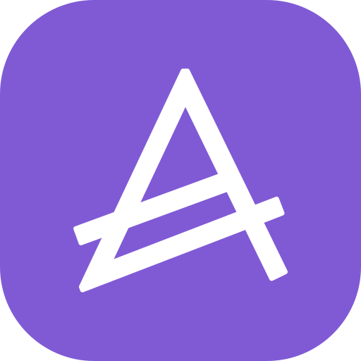
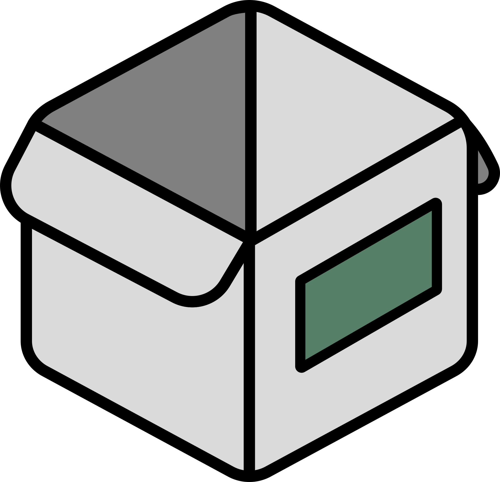
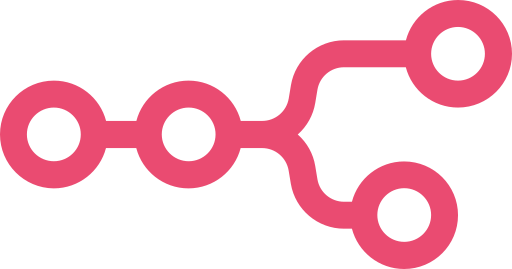
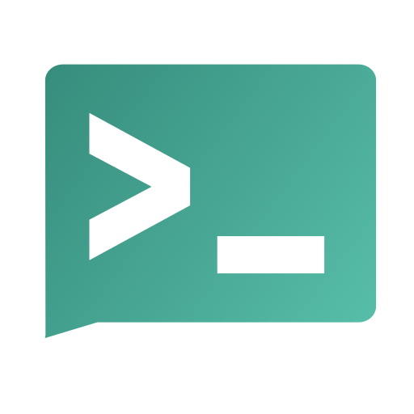
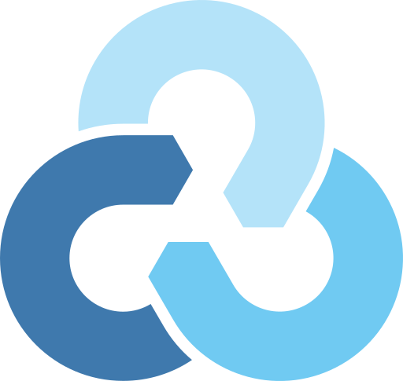

# Quadlet Homelab

**[🇺🇸 Read in English](../../README.md)**

84 serviços self-hosted como units do [Podman Quadlet](https://docs.podman.io/en/latest/markdown/podman-systemd.unit.5.html),
rootless, um serviço por pasta.

## Início rápido

```bash
curl -fsSL https://raw.githubusercontent.com/wallacepnts/quadlet-homelab/main/bootstrap.sh | bash
```

Debian e Ubuntu não trazem `curl` nem `wget` numa instalação crua — medido nas
imagens base dos dois. Ali você vai instalar pacote de qualquer forma, então
instale o `git`, que o bootstrap exige de toda maneira:

```bash
git clone https://github.com/wallacepnts/quadlet-homelab
bash quadlet-homelab/bootstrap.sh
```

Ele confere git/python3/podman e o `systemd --user`, cria as pastas do Podman,
clona o repositório em `~/quadlet-homelab`, liga as ferramentas em `~/.local/bin` e
**sobe o painel web** como um serviço `systemd --user` seu. Sem `sudo`, sem instalar
pacote. Pergunta uma vez de onde você vai abrir o painel (só desta máquina, da rede local
ou da tailnet) e termina mostrando o endereço e o token de login:

```
  painel no ar: http://127.0.0.1:8484
  login (o token): …
```

**Abra esse endereço num navegador: é assim que se usa isto.** O painel tem a Loja (os 83
serviços, por categoria, com capturas de tela) e Meus apps (o que está instalado, como um
lançador). Por ele você instala um app (só pergunta o que aquele app precisa, e deixa
personalizar portas, volumes e variáveis antes, ou experimentar por algumas horas), atualiza com
um botão, faz backup, restaura, muda as configurações, lê os logs ao vivo, abre um console no
container, pausa, para ou remove, e vê a carga, a memória e a temperatura do host. Cada botão
roda o mesmo motor `qh` que um terminal rodaria; nada no painel é uma segunda implementação.

Todo serviço fica acessível em `http://<ip-do-host>:<porta>` sem mais nada
configurado — sem domínio, sem certificado, sem mexer no roteador.

<details>
<summary>O terminal, se você preferir (avançado)</summary>

```bash
qh                   # os serviços
qh memos             # o plano de um, sem instalar
qh memos --apply     # fazer
```

[Instalar e operar](./instalacao.md) lista todos os modos.
</details>

## Atualizando

Duas coisas diferentes, nesta ordem.

**O repositório** — as units e as receitas. Rodar o mesmo comando de novo, ou
dar pull no clone; dá no mesmo:

```bash
curl -fsSL https://raw.githubusercontent.com/wallacepnts/quadlet-homelab/main/bootstrap.sh | bash
```

Ele avança o clone e cria os links que faltam — link que já aponta pra outro
clone ele nomeia, não move. Clone que divergiu é deixado em paz e avisado,
então edição local sua nunca é descartada.

**Os serviços no host** — nada se move até você mandar. No painel, um app com release
nova mostra o botão **Atualizar para X**, e Meus apps tem **Atualizar todos** para os que
têm algo a pegar (cada um reinicia; uma falha não interrompe os outros). Unit mais nova no
repositório não muda o arquivo já instalado. O mesmo, num terminal:

```bash
qh-updates                     # quais imagens estão atrás da release do upstream
qh memos --update --apply      # um serviço
qh --all --update --apply      # depois de uma leva de bumps
```

O `--update` recopia as units, puxa a imagem e reinicia. Não toca em volume,
`.env` nem secret. Serviço que já está em dia é pulado — e isso inclui o
container em execução, não só o arquivo: o Quadlet grava as labels na
criação, então uma unit certa no disco pode estar rodando num container com
as anteriores. Tag móvel (`latest`) é sempre puxada. Para passar por cima,
use `--reinstall`.

## Requisitos

- **Podman 5.0 ou mais novo.** É a régua de verdade: o `Notify=healthy` chegou
  nessa versão, e 119 das 127 units usam. No 4.x o start volta antes de o app
  estar pronto, e a instalação relata um sucesso que ela não tem como saber.
- **systemd com sessão de usuário** e cgroups v2.
- **`network-online.target` alcançado no boot.** O Quadlet ordena toda unit que
  gera atrás do `podman-user-wait-network-online.service`, que gira em
  `until systemctl is-active network-online.target` até o timeout de 90s. Um
  target só é ativado quando alguém o requer, e desktop muitas vezes não requer
  nada — medido no Tumbleweed com KDE, onde o único que pedia era um oneshot já
  terminado. A dependência é `Wants=`, então o serviço sobe: noventa segundos
  atrasado, em cada start.
  `sudo systemctl add-wants multi-user.target network-online.target` resolve, e
  o boot passa a esperar o `NetworkManager-wait-online` — segundos quando a
  máquina tem rede, `NM_ONLINE_TIMEOUT` quando não tem.
- **SELinux**, se a sua distribuição tiver. As units trazem `:Z` em 125 linhas
  de volume; onde não há SELinux elas são ignoradas e nada quebra, mas o
  isolamento por container que elas pedem também não existe. As seis units que
  montam o socket do Podman precisam de mais que rótulo — só `:z` as deixa
  saudáveis e cegas, sem enxergar container nenhum, então elas declaram
  `SecurityLabelType=container_runtime_t` (regra 16 das convenções).
- `/dev/kvm` para os seis serviços de VM, e `/dev/net/tun` para esses mais o
  gluetun. Os dois são `0666` numa instalação usual, então o rootless os
  alcança sem mudar grupo nenhum.
- `/dev/dri`, só para o `vm-chromeos`, que repassa a GPU do host. Esse é
  `0660 root:render`, e funciona sem você entrar nesse grupo apenas porque o
  logind põe uma ACL nele para a **sessão ativa**. Um host headless rodando
  com `enable-linger` e sem seat pode não ter essa ACL, e o sintoma é um
  container que sobe e renderiza por software. Confira com
  `getfacl /dev/dri/renderD128` antes de culpar a imagem.

```bash
podman --version
systemctl is-active network-online.target
```

Medido, instalando o podman em cada uma e lendo a versão:

| Distribuição | Podman | |
| --- | --- | --- |
| Arch | 6.0.2 | funciona |
| openSUSE Tumbleweed, Slowroll | 6.0.2 | funciona |
| openSUSE MicroOS, Aeon, Kalpa | 5.8 | funciona |
| Fedora 42 | 5.8.2 | funciona |
| Debian 13 | 5.4.2 | funciona |
| openSUSE Leap 16.0 | 5.4.2 | funciona |
| Ubuntu 25.04 | 5.4.1 | funciona |
| Ubuntu 24.04 LTS | 4.9.3 | **antiga demais** |
| openSUSE Leap 15.6 | 4.9.5 | **antiga demais** |
| Debian 12 | 4.3.1 | **antiga demais** |

Aeon e Kalpa são MicroOS com desktop e compartilham os repositórios dele. O
Leap Micro segue a geração do Leap que o originou, então a linha 5.x herda o
problema do Leap 15 — ele não publica imagem de container e não foi medido
aqui.

## Serviços

<!-- services:begin (generated from apps/*/app.json: python3 check.py --readme) -->

| Logo | Aplicativo | Descrição |
| --- | --- | --- |
|  | [Actual Budget](../../apps/actual-budget) | Uma ferramenta simples para planejar e acompanhar seu dinheiro. |
|  | [AdGuard Home](../../apps/adguardhome) | Bloqueia anúncios e rastreadores em toda a sua rede. |
|  | [Anki](../../apps/anki) | Um servidor de sincronização para os seus cartões do Anki. |
|  | [any-sync-bundle](../../apps/any-sync-bundle) | Um servidor de sincronização para o app Anytype. |
|  | [Audiobookshelf](../../apps/audiobookshelf) | Um servidor para seus audiolivros e podcasts. |
|  | [Authentik](../../apps/authentik) | Um servidor de login e de login único. |
|  | [Beaver Habits](../../apps/beaverhabits) | Um acompanhador de hábitos simples. |
|  | [Beszel](../../apps/beszel) | Mostra o quanto o seu servidor está ocupado. |
|  | [Calibre-Web-Automated](../../apps/calibre-web-automated) | Leia e gerencie sua biblioteca de ebooks no navegador. |
|  | [CasaOS](../../apps/casa) | Um painel para o servidor doméstico. |
|  | [changedetection.io](../../apps/changedetection) | Avisa quando uma página da web muda. |
|  | [Collabora](../../apps/collabora) | Edite documentos no navegador. |
|  | [CookCLI](../../apps/cookcli) | Guarde suas receitas como arquivos de texto simples. |
|  | [Copyparty](../../apps/copyparty) | Um servidor de arquivos que aceita envios de qualquer aparelho. |
|  | [DocuSeal](../../apps/docuseal) | Assine documentos no seu próprio servidor. |
|  | [Donetick](../../apps/donetick) | Acompanhe as tarefas de casa. |
|  | [Dozzle](../../apps/dozzle) | Leia os logs dos seus containers no navegador. |
|  | [ExcaliDash](../../apps/excalidash) | Um lugar para organizar e compartilhar desenhos do Excalidraw. |
|  | [Faved](../../apps/faved) | Um lugar simples para guardar favoritos. |
|  | [Ferdium Server](../../apps/ferdium-server) | Um servidor de sincronização para o app Ferdium. |
|  | [FileBrowser Quantum](../../apps/filebrowser) | Um gerenciador de arquivos no navegador. |
|  | [FMD Server](../../apps/fmd-server) | Encontre o seu celular Android pelo navegador. |
|  | [FreshRSS](../../apps/freshrss) | Leia todos os seus feeds de notícias num só lugar. |
|  | [Frigate](../../apps/frigate) | Um gravador de câmeras de segurança que reconhece pessoas e objetos. |
|  | [Ghost](../../apps/ghost) | Uma plataforma de blog e newsletter. |
|  | [Gitea](../../apps/gitea) | Um servidor Git simples para o seu código. |
|  | [Gitea Runner](../../apps/gitea-runner) | Executa os fluxos automáticos do seu Gitea. |
|  | [Grafana](../../apps/grafana) | Gráficos e painéis para os seus dados. |
|  | [Headscale](../../apps/headscale) | O seu próprio servidor para uma rede privada. |
|  | [Hermes Agent](../../apps/hermes-agent) | Um assistente de IA pessoal. |
|  | [Home Assistant](../../apps/home-assistant) | Controle todos os seus dispositivos de casa inteligente num só lugar. |
|  | [HomeBox](../../apps/homebox) | Mantenha um inventário de tudo o que você tem. |
|  | [homepage](../../apps/homepage) | Uma página inicial para o seu servidor doméstico. |
|  | [Immich](../../apps/immich) | Faça backup e navegue pelas suas fotos e vídeos. |
|  | [Instagram Monitor](../../apps/instagram-monitor) | Acompanha perfis do Instagram e mostra a atividade deles. |
|  | [Invio](../../apps/invio) | Crie e acompanhe faturas. |
|  | [Karakeep](../../apps/karakeep) | Guarde e pesquise seus favoritos. |
|  | [Karaoke Eternal](../../apps/karaoke-eternal) | Faça festas de karaokê com as suas próprias músicas. |
|  | [Kiwix](../../apps/kiwix) | Leia a Wikipédia e outras bibliotecas sem internet. |
|  | [Koffan](../../apps/koffan) | Uma lista de compras compartilhada. |
|  | [Komga](../../apps/komga) | Leia seus quadrinhos e mangás. |
|  | [LubeLogger](../../apps/lubelogger) | Acompanhe a manutenção dos seus veículos. |
|  | [Mailpit](../../apps/mailpit) | Captura os e-mails que seus apps enviam para você lê-los. |
|  | [mdrop](../../apps/mdrop) | Transforme documentos em Markdown. |
|  | [Media Stack](../../apps/media-stack) | Um servidor de mídia e as ferramentas que o abastecem. |
|  | [Memos](../../apps/memos) | Um lugar simples para notas rápidas. |
|  | [MeTube](../../apps/metube) | Baixe vídeos da web. |
|  | [Monica](../../apps/monica) | Lembre das pessoas da sua vida. |
|  | [n8n](../../apps/n8n) | Automatize tarefas entre os seus apps. |
|  | [neko](../../apps/neko) | Um navegador compartilhado para usar em conjunto. |
|  | [netboot.xyz](../../apps/netbootxyz) | Instale um sistema operacional pela rede. |
|  | [nginx](../../apps/nginx) | Um servidor web para arquivos estáticos. |
|  | [Node-RED](../../apps/node-red) | Automatize coisas ligando blocos. |
|  | [ntfy](../../apps/ntfy) | Envie notificações para o seu celular. |
|  | [Omni Tools](../../apps/omni-tools) | Ferramentas úteis que rodam no seu navegador. |
|  | [Open WebUI](../../apps/openwebui) | Uma interface de chat para modelos de IA. |
|  | [OpenWA](../../apps/openwa) | Envie mensagens de WhatsApp a partir dos seus outros apps. |
|  | [ownCloud](../../apps/owncloud) | A sua própria nuvem de arquivos. |
|  | [OwnTracks](../../apps/owntracks) | Registre a sua localização pelo celular. |
|  | [Paperless-ngx](../../apps/paperless-ngx) | Digitalize e pesquise os seus documentos de papel. |
|  | [PKVault](../../apps/pkvault) | Gerencie os seus arquivos de save de Pokémon. |
|  | [Postfix](../../apps/postfix) | Envia e-mail em nome dos seus outros apps. |
|  | [Postiz](../../apps/postiz) | Agende as suas publicações nas redes sociais. |
|  | [Prometheus](../../apps/prometheus) | Coleta números sobre como os seus serviços funcionam. |
|  | [Proxmox VE](../../apps/proxmox) | Experimente o sistema de virtualização Proxmox. |
|  | [Radicale](../../apps/radicale) | Um servidor de calendários e contatos. |
|  | [rclone](../../apps/rclone) | Mova arquivos entre as suas contas na nuvem. |
|  | [Retrom](../../apps/retrom) | Uma biblioteca para os seus jogos retrô. |
|  | [SearXNG](../../apps/searxng) | Pesquise na web sem ser rastreado. |
|  | [Stirling-PDF](../../apps/stirling-pdf) | Edite e converta arquivos PDF. |
|  | [Syncthing](../../apps/syncthing) | Sincronize arquivos entre os seus dispositivos. |
|  | [Toolbx](../../apps/toolbx) | Shells Linux descartáveis para experimentar coisas. |
|  | [Traccar](../../apps/traccar) | Rastreie veículos e dispositivos por GPS. |
|  | [tsdproxy](../../apps/tsdproxy) | Coloca os seus apps na sua tailnet automaticamente. |
|  | [Uptime Kuma](../../apps/uptime-kuma) | Avisa quando um serviço cai. |
|  | [Vaultwarden](../../apps/vaultwarden) | Um gerenciador de senhas que você hospeda. |
|  | [VaultZap](../../apps/vaultzap) | Navegue pelas suas conversas exportadas do WhatsApp. |
|  | [Vikunja](../../apps/vikunja) | Uma lista de afazeres para tarefas e projetos. |
|  | [VM](../../apps/vm) | Rode Windows, macOS e Linux num container. |
|  | [wger](../../apps/wger) | Planeje e acompanhe os seus treinos. |
|  | [WUD (What's Up Docker)](../../apps/wud) | Avisa quando os seus containers têm atualizações. |
|  | [Zabbix](../../apps/zabbix) | Monitora os seus servidores e a sua rede. |
|  | [Zerobyte](../../apps/zerobyte) | Faz backup dos dados dos seus apps. |
|  | [Zigbee2MQTT](../../apps/zigbee2mqtt) | Use dispositivos Zigbee sem o hub do fabricante. |

<!-- services:end -->

**Nada atualiza sozinho.** Toda imagem é fixada — numa versão, ou num digest
onde o projeto não publica versão — e atualizada na mão; ver
[auto-update](./auto-update.md).

## A rede: Tailscale, Headscale ou só local

A tailnet faz parte do projeto, e uma escolha (perguntada pelo `bootstrap.sh`, trocada no painel em
**Configurações → Rede**, ou com `qh --network`) diz qual:

| Escolha | O que você tem |
| --- | --- |
| **Só local** | Sem tailnet. Os apps abrem na porta da LAN e o tsdproxy fica parado. O jeito mais simples. |
| **Tailscale** | O host entra numa tailnet do [Tailscale](https://tailscale.com) e o tsdproxy dá a cada serviço um nome HTTPS, acessível de qualquer lugar sem abrir porta. O Vaultwarden precisa dela: só decifra a sessão num contexto seguro. |
| **Headscale** | Uma rede sua, sem conta em terceiros: o projeto roda o [Headscale](https://headscale.net) (o app `headscale`), e o host e o tsdproxy entram nele. O Headscale não emite certificado HTTPS, então os apps ficam em HTTP na tailnet (o WireGuard ainda a cifra) e os que exigem HTTPS (Vaultwarden, Actual) precisam da escolha Tailscale. |

```bash
qh --network                                   # onde as coisas estão
qh --network local --apply
qh --network tailscale --apply
qh --network headscale --tailnet <your-tailnet> --apply     # --login-server URL se não for o endereço da LAN
```

O que pede root no host só é mostrado, nunca executado: o Tailscale é pacote do host (ele precisa *ser* o host na
rede), então o plano imprime o que falta, uma vez —

```bash
sudo transactional-update pkg install tailscale     # host imutável; depois reinicie
sudo systemctl enable --now tailscaled
sudo tailscale set --operator=$USER                  # deixa o painel fazer o login do host, sem root
```

— e todo o resto (o login, o servidor Headscale, o usuário e a chave dele, o secret e o `controlUrl` do tsdproxy, o
`TAILNET` das units, a atualização dos apps) são os passos do plano. Com o Tailscale, o tsdproxy pede uma chave
reutilizável do console de admin; com o Headscale, o projeto a cria. Trocar muda a label da porta proxiada dos apps
(uma atualização, que mantém os dados) e é reversível: `--network local` e depois `--network tailscale` é o caminho
de volta.

Sem tailnet, `qh --network local` grava a regra e para o tsdproxy; a regra de mais baixo nível sozinha continua
sendo `qh --set-access local`, que comenta as labels `tsdproxy.*` em vez de apagá-las.

## Num servidor ARM

Quase toda imagem aqui publica variante `arm64` e instala sem mudança. Três
não publicam, e levam o serviço junto:

| Imagem | Serviço |
| --- | --- |
| `dockurr/macos` | `vm-macos` |
| `dockurr/chromeos` | `vm-chromeos` |
| `quay.io/toolbx/arch-toolbox` | `toolbx-arch` |

Nos serviços de VM quem decide é o convidado, não a imagem: o KVM só acelera
convidado da mesma arquitetura. O `apps/vm` traz `vm-windows` pra x86_64 e
`vm-windows-arm` pra ARM64.

## Documentação

| | |
| --- | --- |
| [Instalando e operando](./instalacao.md) | instalar, atualizar, backup, restaurar, remover |
| [Recuperação e migração](./recuperacao.md) | a máquina morreu, ou você está mudando de host |
| [Referência](./referencia.md) | onde cada arquivo mora, e um `.container` anotado |
| [O manifesto do app](./manifesto.md) | `apps/<app>/app.json`: tudo o que um app diz de si mesmo |
| [Auto-update](./auto-update.md) | por que nada atualiza sozinho |
| [Endurecimento, o que foi medido](./endurecimento.md) | o que cada imagem aceitou, e os erros do que ela recusou |
| [Ferramentas](./ferramentas.md) | `qh-check` e `qh-updates` |
